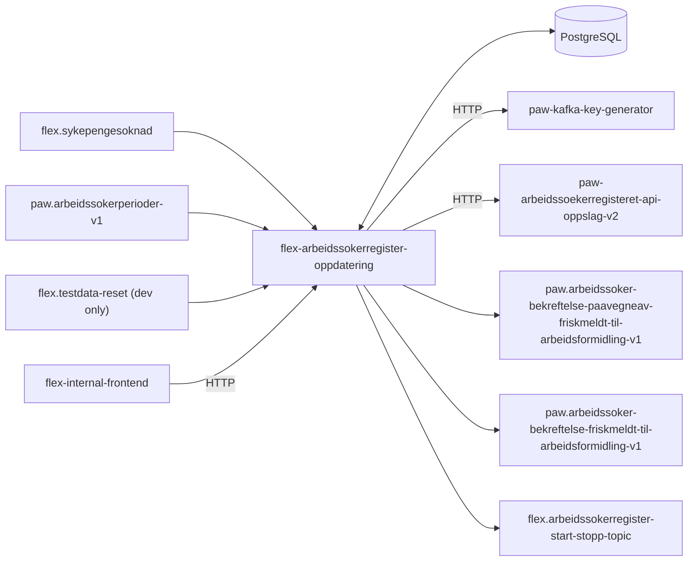

# Application architecture

This document describes the architecture of `flex-arbeidssokerregister-oppdatering` and how data flows through it.
All content comes from the code and configuration in this repository.

## 1. Overview

The service connects sykepengesøknader for Friskmeldt til arbeidsformidling (FTA) to Arbeidssøkerregisteret.
It reads FTA søknader from `flex.sykepengesoknad` and periods from `paw.arbeidssokerperioder-v1`.
It stores one arbeidssøkerperiode for each vedtaksperiode, and one periodebekreftelse for each sent søknad.
It sends PaaVegneAv and Bekreftelse messages to Arbeidssøkerregisteret, and Start/Stopp messages to
`sykepengesoknad-backend`.

## 2. Flows

### 2.0 Shared Kafka consumer behavior

These rules apply to all Kafka consumers. Source: `KafkaConfig`, `KafkaErrorHandler` and the listener classes.

- Auto commit is off. The ack mode is `MANUAL_IMMEDIATE`. The listener acknowledges the offset after processing.
- The consumer group is the listener `id`. No `groupId` is set, so Spring Kafka uses the `id` as the group.
- `auto.offset.reset` is `none` in production and dev (`application.yaml`). The test reset listener overrides it to
  `latest`.
- `max.poll.records` is 100. `max.poll.interval.ms` is 600 000 (10 minutes).
- The common error handler is `KafkaErrorHandler`. It extends `DefaultErrorHandler` with `ExponentialBackOff(1000, 1.5)`
  and a max interval of 8 minutes.
- The back-off has no max attempts and no max elapsed time. The Spring defaults are `Long.MAX_VALUE`. A failing record
  is therefore retried forever and blocks its partition.
- There is no dead-letter topic and no recoverer.
- The unbounded retry is a design decision. `KafkaErrorHandler.handleRemaining` logs an error for each failed attempt.
  The developers monitor these errors and fix the cause.
- `ArbeidssokerperiodeListener` and `SykepengesoknadListener` catch every exception from the service.
  - In `prod-gcp` (`EnvironmentToggles.erProduksjon()`), the listener rethrows. The error handler retries forever.
  - In all other clusters, the listener logs the error and acknowledges the record. The record is skipped.
  - The difference is a design decision. Reason: data in dev is less predictable.
- `SykepengesoknadListener` parses the JSON value outside the `try` block. A parse error is retried forever in all
  clusters, also in dev. This is a design decision. Reason: it shows changes in the søknad format in dev.
- `avroKafkaListenerContainerFactory` has no `ErrorHandlingDeserializer`. A record on `paw.arbeidssokerperioder-v1`
  that cannot be deserialized makes the container poll the same offset again in a loop with no back-off, in all
  clusters. `tasks/fix-architecture-review-issues.md` (I1) describes the fix.

### 2.1 Flow A: New vedtaksperiode (søknad with status FREMTIDIG)

**Trigger:** A record on `flex.sykepengesoknad` with `type = FRISKMELDT_TIL_ARBEIDSFORMIDLING` and
`status = FREMTIDIG`.

**Steps:**

1. `SykepengesoknadListener.listen` parses the JSON value to `SykepengesoknadDTO`. The parse is outside the
   `try` block.
2. `SykepengesoknadService.behandleSoknad` starts a database transaction (`@Transactional`) and selects Flow A.
3. `SykepengesoknadService.behandleVedtaksperiode` stops if `ignorerArbeidssokerregister == true`.
4. `SykepengesoknadService.tilVedtaksperiode` builds a `FriskTilArbeidVedtaksperiode`. It parses
   `friskTilArbeidVedtakPeriode` (a JSON string) to `fom` and `tom`. It requires `friskTilArbeidVedtakId`.
5. `SykepengesoknadService.erNyVedtaksperiode` reads `arbeidssokerperiode` by `vedtaksperiode_id`. The flow stops if a
   row exists.
6. `KafkaKeyGeneratorClient.hentKafkaKey` gets the Kafka record key for the `fnr`.
7. `ArbeidssokerregisterClient.hentSisteArbeidssokerperiode` gets the latest period in Arbeidssøkerregisteret.
8. `SykepengesoknadService` requires exactly one period. Zero or more than one period throws
   `ArbeidssokerperiodeException`.
9. `SykepengesoknadService` requires that the period is not ended (`avsluttet == null`). An ended period throws
   `ArbeidssokerperiodeException`.
10. `ArbeidssokerperiodeRepository.save` inserts a new `arbeidssokerperiode` row. The row holds the key, the registry
    period id and `sendt_paavegneav = now`.
11. `ArbeidssokerperiodePaaVegneAvProducer.send(PaaVegneAvStartMelding)` sends a PaaVegneAv `Start` and waits for the
    broker ack (`.get()`). The interval is 14 days. The grace period comes from `beregnGraceMS(tom, 4)`.
12. The transaction commits. `SykepengesoknadListener` acknowledges the offset.

**Outputs:** One `arbeidssokerperiode` row. One PaaVegneAv `Start` message.

**Error handling:** HTTP errors, a missing period, an ended period and Kafka send errors throw an exception. The
transaction rolls back. See section 2.0 for the retry behavior.

### 2.2 Flow B: Sent søknad (status SENDT)

**Trigger:** A record on `flex.sykepengesoknad` with `type = FRISKMELDT_TIL_ARBEIDSFORMIDLING` and
`status = SENDT`.

**Steps:**

1. `SykepengesoknadListener.listen` parses the record and calls `SykepengesoknadService.behandleSoknad` (transaction
   start).
2. `SykepengesoknadService.behandleBekreftelse` stops if `ignorerArbeidssokerregister == true`.
3. `SykepengesoknadService.behandleBekreftelse` stops if `korrigerer != null`.
4. `ArbeidssokerperiodeRepository.findByVedtaksperiodeId` reads the `arbeidssokerperiode` for
   `friskTilArbeidVedtakId`. No row throws `PeriodebekreftelseException`.
5. `PeriodebekreftelseRepository.findBySykepengesoknadId` checks for an earlier row. The flow stops if a row exists.
6. `SykepengesoknadService` sets `erAvsluttendeSoknad = (vedtaksperiode_tom == soknad.tom)`.
7. `SykepengesoknadService` logs a warning if the søknad is not avsluttende and `fortsattArbeidssoker` is null.
8. `PeriodebekreftelseRepository.save` inserts a `periodebekreftelse` row.
9. `SykepengesoknadService` makes a decision:
   - If the søknad is avsluttende or `fortsattArbeidssoker == false`:
     1. `lagreAvsluttetAarsak` updates `sendt_avsluttet = now` and `avsluttet_aarsak` (`AVSLUTTET_PERIODE` or
        `BRUKER`).
     2. `ArbeidssokerperiodePaaVegneAvProducer.send(PaaVegneAvStoppMelding)` sends a PaaVegneAv `Stopp` and waits for
        the ack.
   - Else: `ArbeidssokerperiodeBekreftelseProducer.send` sends a `Bekreftelse` and waits for the ack.
     `periodeStart` is `soknad.fom` at 00:00 Europe/Oslo. `periodeSlutt` is `soknad.tom + 1 day` at 00:00
     Europe/Oslo. `fortsattArbeidssoker` is always `true`. A new random UUID is the Bekreftelse id.
10. The transaction commits. The listener acknowledges the offset.

**Outputs:** One `periodebekreftelse` row. Either one PaaVegneAv `Stopp` (plus an update of `arbeidssokerperiode`) or
one `Bekreftelse`.

**Error handling:** A missing `arbeidssokerperiode` and Kafka send errors throw an exception. The transaction rolls
back. See section 2.0.

Flow B does not check `sendt_avsluttet` or `avsluttet_mottatt`. This is a design decision. Reason: when a søknad stops
the vedtaksperiode, `sykepengesoknad-backend` deletes the later søknader in it. No later SENDT søknad comes.

Flow B sends `fortsattArbeidssoker = true` when a søknad that is not avsluttende has no answer. This is a design
decision. Reason: a manual change of the vedtaksperiode after the søknad and its questions were made can cause the
missing answer.

### 2.3 Flow C: Expired søknad (status UTGAATT)

**Trigger:** A record on `flex.sykepengesoknad` with `type = FRISKMELDT_TIL_ARBEIDSFORMIDLING` and
`status = UTGAATT`.

**Steps:**

1. `SykepengesoknadListener.listen` parses the record and calls `SykepengesoknadService.behandleSoknad` (transaction
   start).
2. `SykepengesoknadService.behandleUtgattSoknad` reads all `arbeidssokerperiode` rows for the `fnr`.
3. `SykepengesoknadService` keeps rows with `sendt_avsluttet IS NULL` and `avsluttet_aarsak != UTGAATT`.
4. For each row, `lagreAvsluttetAarsak` updates `sendt_avsluttet = now` and `avsluttet_aarsak = UTGAATT`.
5. For each row, `ArbeidssokerperiodePaaVegneAvProducer.send(PaaVegneAvStoppMelding)` sends a PaaVegneAv `Stopp`.
6. The transaction commits. The listener acknowledges the offset.

**Outputs:** Zero or more updated `arbeidssokerperiode` rows. One PaaVegneAv `Stopp` for each row.

**Error handling:** As Flow B.

Flow C stops all open rows for the person. It does not check `ignorerArbeidssokerregister` or the vedtaksperiode id.
These are design decisions. The filter on `avsluttet_aarsak` has no effect, because `sendt_avsluttet` is always set
together with `avsluttet_aarsak`. `tasks/fix-architecture-review-issues.md` (I7) describes the removal.

Søknader with other types or statuses are acknowledged and ignored (`behandleSoknad` has no `else` branch).

### 2.4 Flow D: Period started in Arbeidssøkerregisteret (restart)

**Trigger:** A record on `paw.arbeidssokerperioder-v1` where `Periode.avsluttet == null`.

**Steps:**

1. `ArbeidssokerperiodeListener.listen` receives the Avro `Periode` and calls
   `ArbeidssokerperiodeService.behandlePeriode` (transaction start).
2. `ArbeidssokerperiodeService.finnRestartbarArbeidssokerperiode` reads all rows for `identitetsnummer`. It selects the
   row with the latest `vedtaksperiode_tom`. It never restarts an older row. This is a design decision.
3. `ArbeidssokerperiodeService.aarsakTilAtIkkeRestartbar` checks the row in this order. The first match stops the flow
   and logs the reason:
   1. `avsluttet_mottatt IS NULL` → `IKKE_MOTTATT_AVSLUTTET`.
   2. `sendt_avsluttet IS NOT NULL` → `SENDT_PAA_VEGNE_AV_STOPP`.
   3. `arbeidssokerperiode_id == Periode.id` → `ALLEREDE_RESTARTET`.
   4. `vedtaksperiode_tom` is older than 4 months → `VEDTAKSPERIODE_FOR_GAMMEL`.
4. `ArbeidssokerperiodeService.restartArbeidssokerperiode` updates the row: `arbeidssokerperiode_id = Periode.id`,
   `sendt_paavegneav = now`, `avsluttet_mottatt = null`, `avsluttet_tidspunkt = null`.
5. `ArbeidssokerperiodePaaVegneAvProducer.send(PaaVegneAvStartMelding)` sends a PaaVegneAv `Start` and waits for the
   ack.
6. `ArbeidssokerperiodeStartStoppProducer.send` sends a `START` `StartStoppMelding` with
   `tidspunkt = Periode.startet.tidspunkt`. It does not wait for the ack.
7. The transaction commits. The listener acknowledges the offset.

**Outputs:** One updated `arbeidssokerperiode` row. One PaaVegneAv `Start`. One `START` message.

**Error handling:** See section 2.0. The listener runs with `concurrency = 6`.

### 2.5 Flow E: Period ended in Arbeidssøkerregisteret

**Trigger:** A record on `paw.arbeidssokerperioder-v1` where `Periode.avsluttet != null`.

**Steps:**

1. `ArbeidssokerperiodeListener.listen` calls `ArbeidssokerperiodeService.behandlePeriode` (transaction start).
2. `ArbeidssokerperiodeService.behandleAvsluttetPeriode` reads all rows with `arbeidssokerperiode_id = Periode.id`.
3. `ArbeidssokerperiodeService` keeps rows with `avsluttet_mottatt IS NULL`.
4. For each row, `avsluttArbeidssokerperiode` updates `avsluttet_mottatt = now` and
   `avsluttet_tidspunkt = Periode.avsluttet.tidspunkt`.
5. For each row, `ArbeidssokerperiodeStartStoppProducer.send` sends a `STOPP` `StartStoppMelding`. It does not wait for
   the ack.
6. The transaction commits. The listener acknowledges the offset.

**Outputs:** Zero or more updated `arbeidssokerperiode` rows. One `STOPP` message for each row.

**Error handling:** See section 2.0.

### 2.6 Flow F: Internal API for flex-internal-frontend

**Trigger:** HTTP calls to `/api/v1/flex/**` on `FlexInternalController`.

All endpoints require an Azure AD token from issuer `azureator` (`@ProtectedWithClaims`). Every endpoint first calls
`ClientValidation.validateClientId`. It checks that the `azp` claim is the client id of `flex:flex-internal-frontend` in
`AZURE_APP_PRE_AUTHORIZED_APPS`. NAIS `accessPolicy.inbound` also allows only `flex-internal-frontend`.

The controller has no `@Transactional`. Each repository call runs in its own Spring Data transaction.

| Endpoint                                                  | Steps                                                                                                                                                                                                                                         |
|-----------------------------------------------------------|-----------------------------------------------------------------------------------------------------------------------------------------------------------------------------------------------------------------------------------------------|
| `POST /arbeidssokerperioder`                              | Read rows by `fnr`. For each row, read its `periodebekreftelse` rows. Return all.                                                                                                                                                             |
| `PUT /arbeidssokerperioder/oppdater-tom`                  | Read row by `id` (404 if missing). Save with new `vedtaksperiode_tom`. No Kafka message.                                                                                                                                                      |
| `PUT /arbeidssokerperioder/oppdater-fom`                  | Read row by `id` (404 if missing). Save with new `vedtaksperiode_fom`. No Kafka message.                                                                                                                                                      |
| `PUT /arbeidssokerperioder/oppdater-arbeidssokerperiode-id` | Read row by `id` (404 if missing). Save with new trimmed `arbeidssokerperiode_id`. Then call `SykepengesoknadService.sendPaaVegneAvStartMelding`, which sends a PaaVegneAv `Start` with grace from `beregnGraceMS(vedtaksperiode_tom, 4)`. |

**Error handling:** No explicit handling. An exception gives an HTTP error. A failed send after the save leaves the
saved row in place.

`oppdater-arbeidssokerperiode-id` does not set `sendt_paavegneav`, and does not clear `avsluttet_mottatt` and
`avsluttet_tidspunkt`. If the old registry period ended, Flow E ignores the end of the new registry period.
`tasks/fix-architecture-review-issues.md` (I4) describes the fix.

`oppdater-tom` sends no new PaaVegneAv `Start`. The grace period in Arbeidssøkerregisteret still uses the old `tom`.
`tasks/fix-architecture-review-issues.md` (I5) describes the fix.

### 2.7 Flow G: Test data reset (dev only)

**Trigger:** A record on `flex.testdata-reset`. The value is a `fnr`.

`TestdataResetListener` is active only with Spring profile `test` or `testdatareset`. Only `nais/app/dev.yaml` sets
`testdatareset`.

**Steps:**

1. `TestdataResetListener.listen` reads all `arbeidssokerperiode` rows for the `fnr`.
2. For each row, `PeriodebekreftelseRepository.deleteByArbeidssokerperiodeId` deletes the child rows.
3. For each row, `ArbeidssokerperiodeRepository.delete` deletes the row.
4. The listener acknowledges the offset.

**Error handling:** No `try` block and no transaction. An exception goes to `KafkaErrorHandler` and retries forever.

### 2.8 Order, duplicates and partial failures

**Order:**

- `paw.arbeidssokerperioder-v1` has a `Long` key. Kafka keeps order inside one partition. Six consumer threads share
  the partitions, and each partition has one thread. Order for one key is kept.
- `SykepengesoknadListener` has one consumer thread. This service does not read the key on `flex.sykepengesoknad`. Order
  for one person depends on the producer key, which this repository does not show.
- No order exists between the two input topics. The two listeners run on separate threads.
- Flow B needs the row from Flow A. If a SENDT søknad comes first, Flow B throws and retries (production) or skips
  (dev). This does not occur in practice. A søknad has status FREMTIDIG days before it can be SENDT.
- `flex.arbeidssokerregister-start-stopp-topic` has 1 partition. All Start/Stopp messages have one total order.

**Duplicates:**

| Flow | Duplicate input                                                          | Guard                                                                     |
|------|--------------------------------------------------------------------------|---------------------------------------------------------------------------|
| A    | Same vedtaksperiode again                                                | `findByVedtaksperiodeId` check and `UNIQUE (vedtaksperiode_id)`.          |
| B    | Same søknad id again                                                     | `findBySykepengesoknadId` check. No unique constraint in the database.    |
| C    | Second UTGAATT søknad                                                    | Filter on `sendt_avsluttet IS NULL`.                                      |
| D    | Same started `Periode` again                                             | `ALLEREDE_RESTARTET` check.                                               |
| E    | Same ended `Periode` again                                               | Filter on `avsluttet_mottatt IS NULL`.                                    |
| F    | Same `oppdater-arbeidssokerperiode-id` call again                        | None. Each call sends a new PaaVegneAv `Start`.                           |

**Partial failures:**

- The Kafka producers are not transactional. A send is not part of the database transaction.
- The Avro producers (PaaVegneAv and Bekreftelse) wait for the broker ack inside the transaction. A send failure
  throws, and the database transaction rolls back. The database and Kafka stay consistent in this case.
- If the send succeeds and the commit then fails, the message is out and the row is not. The retry sends the message
  again. For Bekreftelse, the retry uses a new random UUID. `tasks/fix-architecture-review-issues.md` (I2) describes
  the fix.
- `ArbeidssokerperiodeStartStoppProducer` does not wait for the ack and has no callback. A failed async send is lost.
  The transaction still commits. `tasks/fix-architecture-review-issues.md` (I3) describes the fix.
- Flow F saves first and sends after, without a transaction. A failed send leaves the new `arbeidssokerperiode_id` in
  the database without a PaaVegneAv `Start`. An id that is not a UUID is saved, and then the producer throws.
  `tasks/fix-architecture-review-issues.md` (I4) describes the fix.

## 3. Data stores

The database is PostgreSQL (Cloud SQL) with Flyway migrations in `src/main/resources/db/migration`. Access goes
through Spring Data JDBC `CrudRepository` interfaces.

| Table / entity                                                         | What it holds                                                                                                                                                         | Written by                                     | Read by                     | Deleted by |
|------------------------------------------------------------------------|-----------------------------------------------------------------------------------------------------------------------------------------------------------------------|------------------------------------------------|-----------------------------|------------|
| `arbeidssokerperiode` / `Arbeidssokerperiode` (`ArbeidssokerperiodeRepository`)  | One row for each FTA vedtaksperiode. It links the vedtaksperiode to a period in Arbeidssøkerregisteret and tracks PaaVegneAv state.                       | Flows A, B, C, D, E, F                         | Flows A, B, C, D, E, F, G   | Flow G     |
| `periodebekreftelse` / `Periodebekreftelse` (`PeriodebekreftelseRepository`)     | One row for each processed SENDT søknad. It holds the user answers and whether the søknad was avsluttende. `arbeidssokerperiode_id` is a foreign key to `arbeidssokerperiode.id`. | Flow B                                         | Flows B, F                  | Flow G     |

Indexes exist on `arbeidssokerperiode (vedtaksperiode_id, fnr, opprettet, arbeidssokerperiode_id)` and on
`periodebekreftelse (arbeidssokerperiode_id, sykepengesoknad_id, opprettet, (fortsatt_arbeidssoker, inntekt_underveis))`.

The table `vedtaksperiode_exception` (V15) was dropped in V19. No code uses it.

`periodebekreftelse.avsluttende_soknad` is nullable. Rows from before V11 have `NULL`. Spring Data JDBC uses the Kotlin
default value, so `Periodebekreftelse.avsluttendeSoknad` is `false` for these rows. `flex-internal-frontend` handles
this.

Flyway does not run `v21__slett_bigquery_datastream_grants.sql`, because the name starts with a lowercase `v`.
`tasks/fix-architecture-review-issues.md` (I8) describes the fix.

**Transaction boundaries:**

- `SykepengesoknadService.behandleSoknad`: one transaction for each `flex.sykepengesoknad` record.
- `ArbeidssokerperiodeService.behandlePeriode`: one transaction for each `paw.arbeidssokerperioder-v1` record.
- `FlexInternalController` and `TestdataResetListener`: no surrounding transaction.
- HTTP calls in Flow A run inside the open database transaction.

## 4. External integrations

### Kafka topics

| Topic                                                                     | Direction | Format                  | Key                                              | Consumer group / producer                                                | Owner     |
|---------------------------------------------------------------------------|-----------|-------------------------|--------------------------------------------------|--------------------------------------------------------------------------|-----------|
| `flex.sykepengesoknad`                                                    | In        | JSON `SykepengesoknadDTO` | `String` (not used)                              | `flex-arbeidssokerregister-oppdatering-sykepengesoknad-v5` (`SykepengesoknadListener`) | Flex      |
| `paw.arbeidssokerperioder-v1`                                             | In        | Avro `Periode`          | `Long` (not used)                                | `flex-arbeidssokerregister-oppdatering-periode-v3` (`ArbeidssokerperiodeListener`, concurrency 6) | PAW       |
| `flex.testdata-reset`                                                     | In (dev)  | String `fnr`            | `String` (not used)                              | `flex-arbeidssokerregister-oppdatering-testdatareset-v1` (`TestdataResetListener`) | Flex      |
| `paw.arbeidssoker-bekreftelse-paavegneav-friskmeldt-til-arbeidsformidling-v1` | Out       | Avro `PaaVegneAv` (`Start` / `Stopp`) | `Long` `kafka_record_key`              | `ArbeidssokerperiodePaaVegneAvProducer` (flows A, B, C, D, F)            | PAW       |
| `paw.arbeidssoker-bekreftelse-friskmeldt-til-arbeidsformidling-v1`        | Out       | Avro `Bekreftelse`      | `Long` `kafka_record_key`                        | `ArbeidssokerperiodeBekreftelseProducer` (flow B)                        | PAW       |
| `flex.arbeidssokerregister-start-stopp-topic`                             | Out       | JSON `StartStoppMelding` | `String` name-based UUID of `fnr`               | `ArbeidssokerperiodeStartStoppProducer` (flows D, E)                     | Flex (this service writes, `sykepengesoknad-backend` reads) |

Producer settings: `acks=all`, `retries=10`, `retry.backoff.ms=100`. Avro uses the Confluent schema registry. Avro
deserialization accepts only classes in `no.nav.paw.arbeidssokerregisteret.api` and `no.nav.paw.bekreftelse`.

### HTTP APIs

| Target                                        | Client                                                     | Call                                                         | Purpose                                                    |
|-----------------------------------------------|------------------------------------------------------------|--------------------------------------------------------------|------------------------------------------------------------|
| `paw-kafka-key-generator` (namespace `paw`)   | `KafkaKeyGeneratorClient` (`kafkaKeyGeneratorRestClient`)  | `POST /api/v1/record-key` with `{ident}`                     | Get the `Long` Kafka key for a person (Flow A).            |
| `paw-arbeidssoekerregisteret-api-oppslag-v2` (namespace `paw`) | `ArbeidssokerregisterClient` (`arbeidssokerregisterRestClient`) | `POST /api/v1/veileder/arbeidssoekerperioder?siste=true` with `{identitetsnummer}` | Get the latest period in Arbeidssøkerregisteret (Flow A). |

Both clients are Spring `RestClient` on Apache HttpClient 5 (`RestClientConfig`):

- Connect timeout: 5 seconds. Response timeout: 10 seconds. Linkerd outbound connect timeout: 10 seconds.
- Pool: 10 connections in total and per route.
- Auth: Azure AD client credentials token, cached (`@EnableOAuth2Client(cacheEnabled = true)`).
- Failures: `retrieve()` throws on 4xx and 5xx. Timeouts throw. No client retry exists. The exception goes up to the
  Kafka listener (section 2.0).

### Inbound HTTP

| Caller                  | Endpoints        | Auth                                                   |
|-------------------------|------------------|--------------------------------------------------------|
| `flex-internal-frontend` | `/api/v1/flex/**` | Azure AD (`azureator`) and `azp` check in `ClientValidation`. |

## 5. Field change sources

### `arbeidssokerperiode`

| Column                | Set or changed by                                                                    |
|-----------------------|--------------------------------------------------------------------------------------|
| `id`                  | Flow A (database default `uuid_generate_v4()` on insert).                            |
| `fnr`                 | Flow A.                                                                              |
| `vedtaksperiode_id`   | Flow A.                                                                              |
| `vedtaksperiode_fom`  | Flow A. Flow F (`oppdater-fom`).                                                     |
| `vedtaksperiode_tom`  | Flow A. Flow F (`oppdater-tom`).                                                     |
| `opprettet`           | Flow A.                                                                              |
| `kafka_record_key`    | Flow A.                                                                              |
| `arbeidssokerperiode_id` | Flow A. Flow D (restart). Flow F (`oppdater-arbeidssokerperiode-id`).            |
| `sendt_paavegneav`    | Flow A. Flow D (restart).                                                            |
| `avsluttet_mottatt`   | Flow E (set). Flow D (set to null).                                                  |
| `avsluttet_tidspunkt` | Flow E (set). Flow D (set to null).                                                  |
| `sendt_avsluttet`     | Flow B (avsluttende søknad or `fortsattArbeidssoker == false`). Flow C.              |
| `avsluttet_aarsak`    | Flow B (`AVSLUTTET_PERIODE` or `BRUKER`). Flow C (`UTGAATT`).                        |

Flow G deletes rows.

### `periodebekreftelse`

| Column                   | Set or changed by                                         |
|--------------------------|-----------------------------------------------------------|
| `id`                     | Flow B (database default `uuid_generate_v4()` on insert). |
| `arbeidssokerperiode_id` | Flow B.                                                   |
| `sykepengesoknad_id`     | Flow B.                                                   |
| `fortsatt_arbeidssoker`  | Flow B.                                                   |
| `inntekt_underveis`      | Flow B.                                                   |
| `opprettet`              | Flow B.                                                   |
| `avsluttende_soknad`     | Flow B.                                                   |

No flow updates a `periodebekreftelse` row after insert. Flow G deletes rows.

## 6. Invariants

1. One `arbeidssokerperiode` row exists for each vedtaksperiode id. **(verified)** `UNIQUE (vedtaksperiode_id)` and `erNyVedtaksperiode`.
2. A `periodebekreftelse` row always points to an existing `arbeidssokerperiode` row. **(verified)** Foreign key in V8.
3. Flow G deletes `periodebekreftelse` rows before the parent `arbeidssokerperiode` row. **(verified)** Code order and the foreign key.
4. Only an FTA søknad with status FREMTIDIG and without `ignorerArbeidssokerregister` creates an `arbeidssokerperiode`. **(verified)** `behandleSoknad` and `behandleVedtaksperiode`.
5. Flow A creates a row only if Arbeidssøkerregisteret returns exactly one period that is not ended. **(verified)** `singleOrNull` and the `avsluttet` check.
6. Flow A gets the Kafka key before it calls Arbeidssøkerregisteret and before it writes. **(verified)** Code order in `behandleVedtaksperiode`.
7. Every PaaVegneAv and Bekreftelse message uses `kafka_record_key` from `paw-kafka-key-generator` as key. **(verified)** The only source of `kafkaRecordKey` is Flow A.
8. Every `StartStoppMelding` uses the name-based UUID of `fnr` as key. **(verified)** `asProducerRecordKey`.
9. A PaaVegneAv or Bekreftelse send must succeed before the database transaction commits. **(verified)** `.get()` inside `@Transactional`.
10. A `StartStoppMelding` send is not part of the commit decision. **(verified)** No `.get()` and no callback.
11. One `flex.sykepengesoknad` record is one database transaction. **(verified)** `@Transactional` on `behandleSoknad`.
12. One `paw.arbeidssokerperioder-v1` record is one database transaction. **(verified)** `@Transactional` on `behandlePeriode`.
13. Kafka offsets are committed only after processing. **(verified)** `enable.auto.commit=false`, `MANUAL_IMMEDIATE`, and `acknowledge()` after the service call.
14. In production, a failing record blocks its partition until it succeeds. **(verified)** Rethrow plus unbounded `ExponentialBackOff`.
15. Outside production, a failing service call skips the record. **(verified)** `erProduksjon()` check and `acknowledge()`.
16. A korrigerende søknad never creates a `periodebekreftelse`. **(verified)** `korrigerer != null` check.
17. At most one `periodebekreftelse` exists for each søknad id. **(inferred)** A read check exists. No unique constraint exists. The rule depends on one consumer thread.
18. A Bekreftelse is sent only when the søknad is not avsluttende and `fortsattArbeidssoker != false`. **(verified)** The `if` in `behandleBekreftelse`.
19. `sendt_avsluttet` and `avsluttet_aarsak` are always written together. **(verified)** Only `lagreAvsluttetAarsak` writes them.
20. Flow C sends at most one PaaVegneAv `Stopp` for each row. **(verified)** Filter on `sendt_avsluttet IS NULL`.
21. Flow E updates each row at most once for each registry period. **(verified)** Filter on `avsluttet_mottatt IS NULL`.
22. Flow D restarts only the row with the latest `vedtaksperiode_tom` for the person. **(verified)** `maxByOrNull`.
23. Flow D restarts a row only if the end was received, no `Stopp` was sent, the registry id is new and `tom` is at most 4 months old. **(verified)** `aarsakTilAtIkkeRestartbar`.
24. A restart always sets `sendt_paavegneav` and clears `avsluttet_mottatt` and `avsluttet_tidspunkt`. **(verified)** `restartArbeidssokerperiode`.
25. Only `flex-internal-frontend` can call `/api/v1/flex/**`. **(verified)** `@ProtectedWithClaims`, `ClientValidation` and NAIS `accessPolicy`.
26. Test data reset runs only in dev. **(verified)** `@Profile("test", "testdatareset")` and `SPRING_PROFILES_ACTIVE` in `dev.yaml`.
27. A FREMTIDIG søknad for a vedtaksperiode is processed before its SENDT søknader. **(inferred)** Flow B depends on it. Nothing enforces it.
28. This service is the only writer to its database. **(inferred)** No other writer appears in the configuration.
29. Arbeidssøkerregisteret owns the period state. This service only mirrors it in `arbeidssokerperiode_id`, `avsluttet_mottatt` and `avsluttet_tidspunkt`. **(inferred)**
30. Listeners call services. Services call repositories, producers and clients. **(inferred)** No architecture test exists. `FlexInternalController` calls repositories directly.
31. Only one writer updates an `arbeidssokerperiode` row at a time. **(inferred)** The entity has no `@Version`. `save` writes all columns. Nothing enforces the rule. `tasks/fix-architecture-review-issues.md` (I6) describes the fix.

## 7. Glossary

| Term                              | Meaning                                                                                                                                              |
|-----------------------------------|------------------------------------------------------------------------------------------------------------------------------------------------------|
| Arbeidssøkerregisteret            | The NAV register of job seekers. Team PAW owns it.                                                                                                   |
| Arbeidssøkerperiode               | A row in `arbeidssokerperiode`. It is this service's link between one vedtaksperiode and one period in Arbeidssøkerregisteret.                      |
| Periode / registry period         | A period in Arbeidssøkerregisteret (Avro `Periode`). Its id is stored in `arbeidssokerperiode.arbeidssokerperiode_id`. `tasks/migrate-database-column.md` renames the column. |
| Friskmeldt til arbeidsformidling (FTA) | A sykepenger scheme for people who are fit for work and look for a job. Søknad type `FRISKMELDT_TIL_ARBEIDSFORMIDLING`.                        |
| Vedtaksperiode                    | The FTA decision period. Fields `friskTilArbeidVedtakId` and `friskTilArbeidVedtakPeriode` on the søknad.                                           |
| Søknad (sykepengesøknad)          | A `SykepengesoknadDTO` on `flex.sykepengesoknad`.                                                                                                    |
| FREMTIDIG / SENDT / UTGAATT       | Søknad statuses: future, submitted and expired.                                                                                                      |
| Korrigerende søknad               | A søknad that corrects an earlier one (`korrigerer != null`).                                                                                        |
| Avsluttende søknad                | A søknad where `tom` equals `vedtaksperiode_tom`. It is the last søknad in the vedtaksperiode.                                                      |
| `ignorerArbeidssokerregister`     | A søknad flag. When true, Flows A and B do nothing.                                                                                                 |
| PaaVegneAv                        | A message that tells Arbeidssøkerregisteret that this service sends Bekreftelser on behalf of the person (`Start`) or stops doing so (`Stopp`).       |
| Bekreftelse                       | A message to Arbeidssøkerregisteret that confirms the person is still a job seeker for a period.                                                    |
| Periodebekreftelse                | A row in `periodebekreftelse`. It records the answers from one SENDT søknad.                                                                        |
| StartStoppMelding                 | A JSON message to `sykepengesoknad-backend` that says a registry period started (`START`) or ended (`STOPP`).                                        |
| Restart                           | Flow D. It moves an `arbeidssokerperiode` to a new registry period after the old one ended.                                                         |
| `AvsluttetAarsak`                 | Why a PaaVegneAv `Stopp` was sent: `BRUKER`, `AVSLUTTET_PERIODE` or `UTGAATT`.                                                                       |
| `kafka_record_key`                | The `Long` key from `paw-kafka-key-generator` for a person. PAW topics use it as the Kafka key.                                                     |
| graceMS                           | The grace period in the PaaVegneAv `Start`: milliseconds from `vedtaksperiode_tom + 1 day` to 4 months later (`beregnGraceMS`).                     |
| PAW                               | The team that owns Arbeidssøkerregisteret and the `paw.*` topics.                                                                                    |
| Flex                              | The team that owns this service and the `flex.*` topics.                                                                                             |

## 8. Open questions

No open questions.
